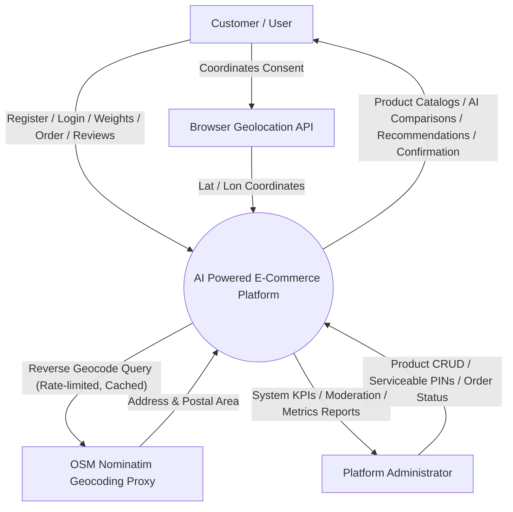

# Data Flow Diagrams (DFD)

## DFD Level-0: Context Diagram
The Level-0 Context Diagram illustrates the global interaction of external entities with the AI Powered E-Commerce Platform.

---

## DFD Level-1: Detailed Process Flow
Decomposes the system into 7 primary processing modules and their associated data stores.

```mermaid
graph TD
    Customer["Customer"]
    Admin["Admin"]
    Geo["Browser Geolocation API"]
    OSM["OSM Nominatim Proxy"]

    %% Data Stores
    D1[("D1: Users & Preferences")]
    D2[("D2: Products & Specs")]
    D3[("D3: Comparisons & Scores")]
    D4[("D4: Addresses & PIN Codes")]
    D5[("D5: Carts & Orders")]
    D6[("D6: Reviews & Sentiments")]
    D7[("D7: Interaction Logs")]

    %% Processes
    P1["1.0 Authentication & User Profiling"]
    P2["2.0 Catalog & Search Engine"]
    P3["3.0 Multi-Criteria AI Comparison"]
    P4["4.0 Location Detection & Delivery Verification"]
    P5["5.0 Cart & Sandbox Checkout"]
    P6["6.0 Hybrid Recommendations & NLP"]
    P7["7.0 Admin Oversight & Catalogue Control"]

    %% Flows
    Customer -->|Credentials| P1
    P1 <-->|Read/Write User Data| D1
    P1 -->|Auth Token| Customer

    Customer -->|Search / Category Filter| P2
    P2 <-->|Fetch Products & Specs| D2
    P2 -->|Interaction Events| D7
    P2 -->|Product Results| Customer

    Customer -->|Select 2 Products + Weight Sliders| P3
    P3 <-->|Specs, Bayesian Ratings| D2
    P3 <-->|Sentiment Scores| D6
    P3 -->|Persist Output| D3
    P3 -->|Scores, Pros/Cons, Plain Explanation| Customer

    Customer -->|Option A: GPS Click| Geo
    Geo -->|Latitude / Longitude| P4
    P4 <-->|Reverse Geocoding Proxy| OSM
    Customer -->|Option B: Manual / Saved Address| P4
    P4 <-->|Verify PIN Serviceability| D4
    P4 -->|Editable Address & Estimated Days| Customer

    Customer -->|Cart Items & Confirmed Address| P5
    P5 <-->|Stock Lock & Order Persistence| D5
    P5 <-->|Decrement Stock| D2
    P5 -->|Confirmed Sandbox Order| Customer

    Customer -->|Browse / Interactions| P6
    P6 <-->|Interaction History| D7
    P6 <-->|TF-IDF Feature Matching| D2
    P6 -->|Personalized Suggestions| Customer

    Customer -->|Product Rating & Review Text| P6
    P6 -->|VADER Analysis & Aspect Mining| D6

    Admin -->|Catalogue CRUD / PIN Add / Order Update| P7
    P7 <-->|Update Database| D2
    P7 <-->|Update Serviceable Areas| D4
    P7 <-->|Update Orders & Delivery| D5
    P7 -->|Business Reports & Analytics| Admin
```

