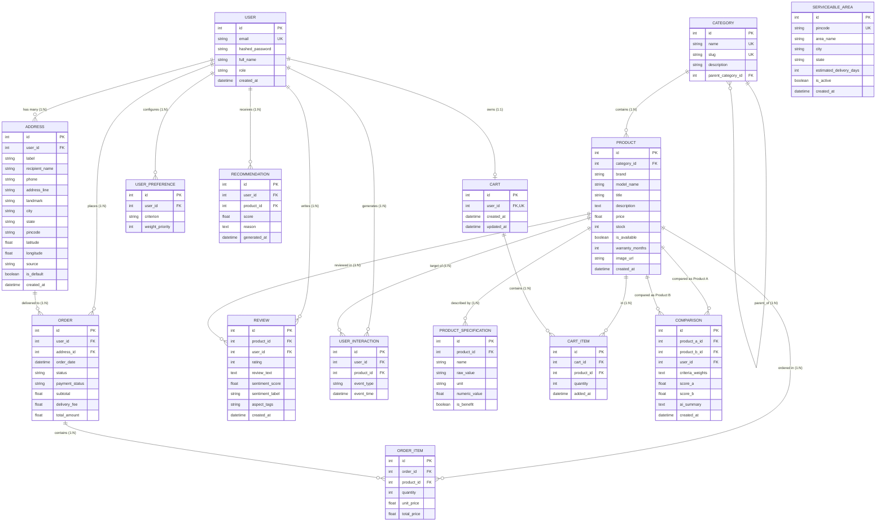

# Entity-Relationship (ER) Diagram

## Database Design (Normalized to 3NF)
This database schema models all entities for the **AI Powered E-Commerce Customer Intelligence and Personalized Recommendation Platform** (B.Tech Minor Project, Poornima University).

